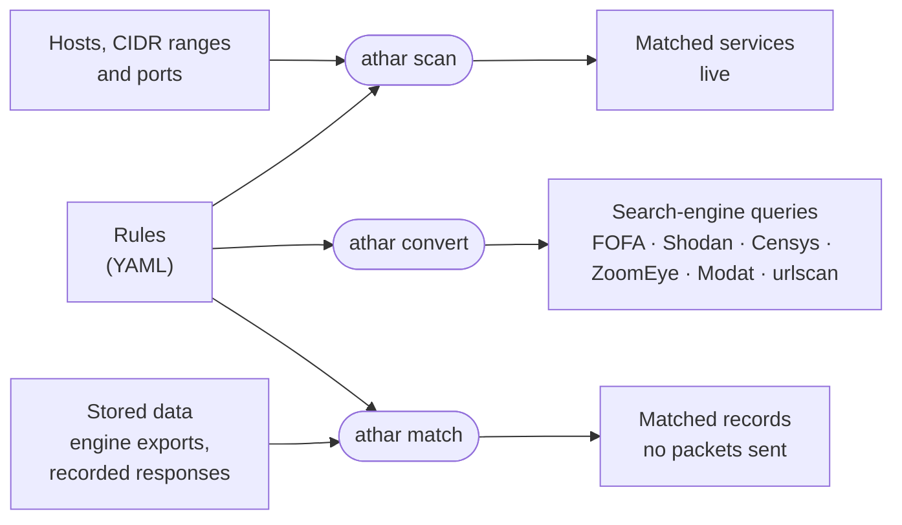
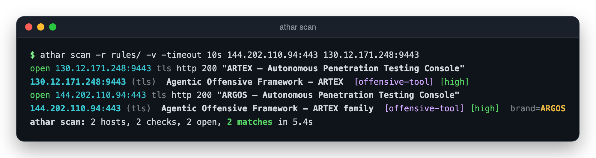
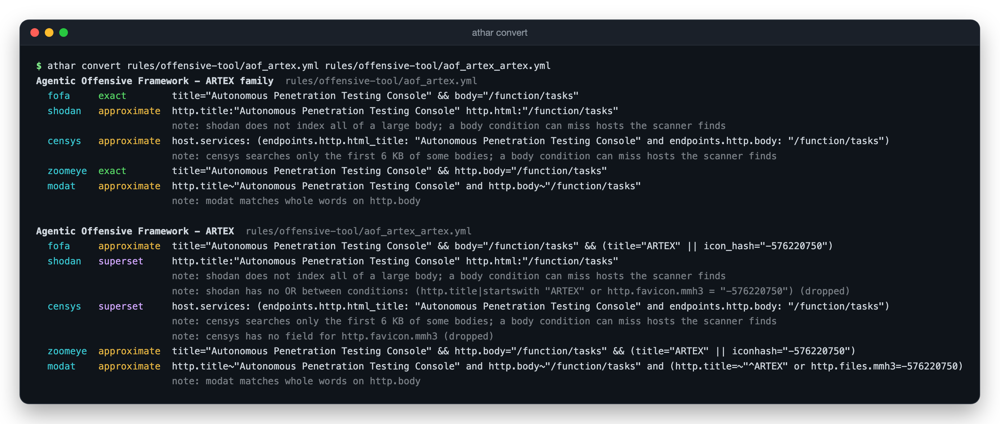
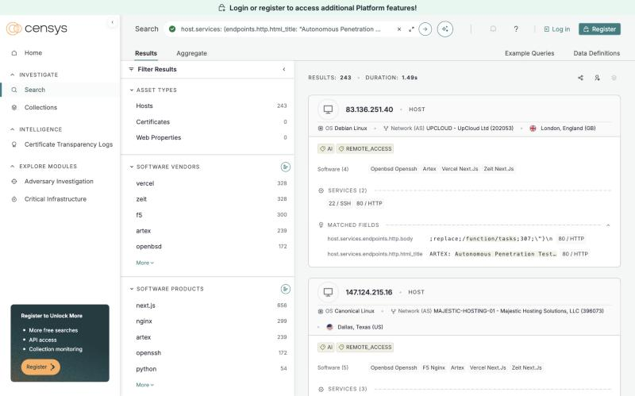
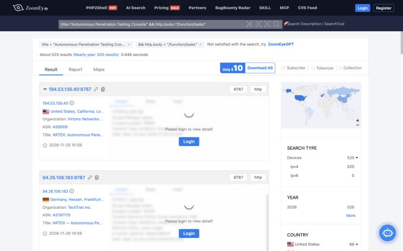
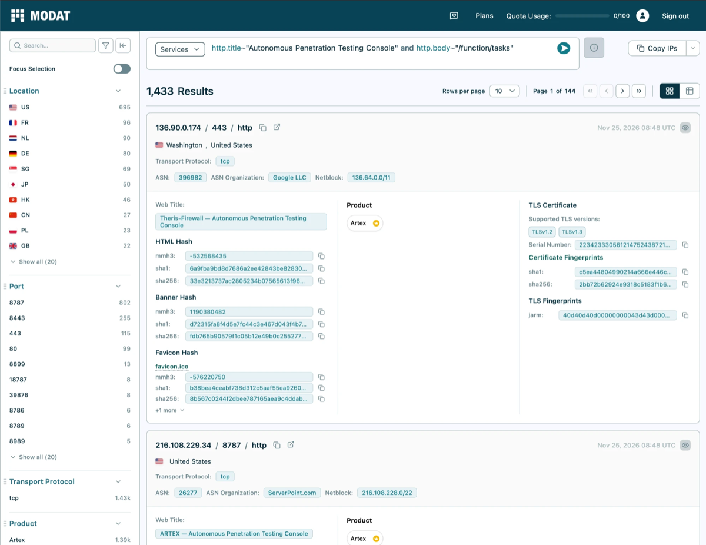

<p align="center">
  
</p>

# Athar

**Athar** is a service fingerprinting project built around a draft standard for portable YAML rules. Each rule describes one network service using observable signals such as HTTP headers, TLS certificates, or response banners.

- **Rule standard.** Define service fingerprints in YAML with Sigma-style detection logic and test cases.
- **Query converter.** Translate the same rules into queries for FOFA, Shodan, Censys, ZoomEye, Modat Magnify and urlscan.io to find candidate services in indexed scan data.
- **Scanner.** Apply those rules to live services on specified hosts or network ranges to identify products, families, and versions.

> **Status: draft.** The rule format can still change. The Go CLI supports `athar scan` for live scanning, `athar convert` for search-engine queries and `athar verify` for syntax checks and rule tests; matching against stored data is planned. Binaries are on the [latest release](https://github.com/Athar-HQ/Athar/releases/latest).

The first use case is the infrastructure of **agentic offensive frameworks (AOFs)**: AI-driven penetration testing consoles that are deployed under changing brand names. The format is not limited to them; C2 panels, phishing kits, appliances and ordinary server software fit the same way.

Our [slide deck](https://www.figma.com/deck/tFRGgSho2sEiq8mjW9pif8) explains the project visually: the problem, what a rule looks like, the CLI, and a real hunt for the ARTEX family.

<p align="center">
  <a href="https://www.figma.com/deck/tFRGgSho2sEiq8mjW9pif8"></a>
</p>

## Why

Every infrastructure hunt gets published three or four times, once per search engine, as hand-written query strings. Those strings drift apart, break when an engine changes its syntax (Censys [deprecated Legacy Search](https://censys.com/blog/legacy-search-deprecation/) in September 2026), and can't be tested.

Existing fingerprint formats each cover part of the problem. Nmap's probe database is tied to Nmap's licence, Recog produces no queries, Nuclei templates are built for vulnerabilities, and Wappalyzer went closed-source. None of them combines an engine-neutral field set, Sigma-style logic, query conversion and active confirmation. [docs/prior-art.md](docs/prior-art.md) compares them.

## A rule

If you can read a Sigma rule, you can read this one. The metadata and the `detection` block are Sigma. New are `target`, `identifies`, `confidence` and `tests`.

```yaml
title: Agentic Offensive Framework - ARTEX family
id: e16df89b-108c-4364-8b69-d5bc6ef04b5f
status: experimental
author: Gameel Ali (@MalGamy12)
date: 2026-11-24
target:
  protocol: http
detection:
  selection:
    http.title|contains: 'Autonomous Penetration Testing Console'
  condition: selection
identifies:
  family: artex
  category: offensive-tool
confidence: high
tests:
  - name: ARTEX console
    response:
      http.title: 'ARTEX — Autonomous Penetration Testing Console'
    expect: match
  - name: Pentest vendor page
    response:
      http.title: 'Penetration Testing Services | Example Corp'
    expect: no_match
```

- **`target`**: the rule is about HTTP services.
- **`detection`**: the page title contains `Autonomous Penetration Testing Console`. Every brand of this console keeps that phrase in its title, so one condition finds all the rebrands.
- **`identifies`** and **`confidence`**: what a match is, and how sure the rule is about it.
- **`tests`**: a page the rule must match and a near miss it must not. `athar verify` runs them, and CI rejects a rule whose tests fail.

The same rule drives every command: `athar scan` checks it against live services, `athar convert` turns it into a query for each search engine.

This is a shortened version of the real rule, [rules/offensive-tool/aof_artex_nov26.yml](rules/offensive-tool/aof_artex_nov26.yml), which also matches the Chinese and Korean titles, reads the brand name out of the title with `extract`, and lists the ports these consoles use.

## How it works

The rules are the only thing the commands share. Each command takes the rules plus its own input, and none of them needs another command to run first.



- **`athar scan`** checks live services. Give it rules, hosts or CIDR ranges, and the ports to check (`-p`, as in Nmap). It connects to each port, sends the baseline request, evaluates every rule on the response, and reports each match with product, family, extracted values such as brand or version, and confidence.
- **`athar convert`** turns rules into search-engine queries, to find candidates on the internet without scanning yourself. Each query is labelled `exact`, `approximate`, `superset` or `unsupported`, because engines tokenize text, lack operators or index only part of a body.
- **`athar match`** (planned) applies rules to data you already have, such as results exported from a search engine. It runs the exact rule logic, which removes the over-matches of approximate queries without sending a packet.

```bash
athar scan -r rules/ -p 80,443,8000-8100 10.0.0.0/24
```

For internet-wide hunting the commands can be combined: run a converted query in the engine, filter the export with `athar match`, then pass the remaining hosts to `athar scan` to confirm they are still live. That is one way to use them together, not a required order.

The **scanner defines what a rule means**. `match` and `scan` use the same evaluator as `verify`, so an engine query can be loose without making the results wrong.

`athar scan`, `athar convert` and `athar verify` are available; `match` is planned. See [CLI](#cli).

## Principles

1. **Simple.** One rule describes one service in one YAML file. Rules use Sigma's grammar rather than a new one. A feature goes into the format only when real rules need it, and [docs/decisions.md](docs/decisions.md) lists the ideas that are waiting for that.
2. **Engine-neutral.** A rule describes properties of a response, never engine syntax. Engine syntax lives in the converters, so a change like Censys's new query language gets fixed in one place.
3. **The scanner defines meaning.** Rule semantics are defined against the raw response. Engine queries are approximations that declare their fidelity.
4. **Passive first, active to confirm.** Rules that only use the baseline request (what engines index anyway) are fully convertible. Extra probes are opt-in, safe by construction, and make those parts active-only.
5. **Identify, don't just alert.** A match yields product, vendor, family, version and CPE, as Recog and Nmap do.
6. **Tested.** Every rule carries example responses that run as tests on every pull request, so an edit that breaks a rule cannot merge.
7. **Licence-clean.** Rules are shared under the Detection Rule License (DRL) 1.1, as Sigma rules are. Encumbered methods such as JA4S/JA4X are optional fields, never required.

## Scope

One rule matches **one service**: one IP address and one port. Fingerprints that only work when two ports of the same host are combined are deliberately left out for now. [docs/decisions.md](docs/decisions.md#multi-service-fingerprints) explains why and how they could be added later without changing existing rules.

## Repository layout

```text
.
├── README.md               this file
├── AGENTS.md               instructions for AI agents (CLAUDE.md points to it)
├── LICENSE.Detection.Rules.md  Detection Rule License 1.1 for the rules
├── spec/
│   └── athar-spec.md       the rule format (normative)
├── rules/                  the rule collection, one folder per category
│   ├── README.md           naming, required tests, rule template
│   └── offensive-tool/
├── cli/                    the athar command-line tool (Go)
│   └── README.md           commands, architecture, how to release
├── go.mod                  Go module for the CLI
├── scripts/
│   └── build-release.sh    builds the release archives
├── .github/workflows/      CI on every push; release build on version tags
└── docs/
    ├── prior-art.md        existing formats and what Athar takes from each
    ├── decisions.md        decided, open and deferred design questions
    └── images/
```

## CLI

`athar` is a single binary written in Go ([why Go](docs/decisions.md#cli-in-go)).

| Command | Status | What it does |
| --- | --- | --- |
| `athar scan` | available | Checks hosts, CIDR ranges and ports for services that match the rules; writes the matches as JSONL. |
| `athar verify` | available | Checks rules against the spec and runs every rule's tests. |
| `athar convert` | available | Turns rules into FOFA, Shodan, Censys, ZoomEye, Modat Magnify or urlscan.io queries, with fidelity and notes. |
| `athar match` | planned | Evaluates rules against stored data (engine exports, recorded responses) without sending packets. |

### Install

Download the archive for your platform (Linux, macOS, Windows; amd64 and arm64) from the [latest release](https://github.com/Athar-HQ/Athar/releases/latest) and put `athar` on your `PATH`. `checksums.txt` in the release lists the SHA-256 of every archive. The binaries are not signed yet; on macOS, clear the quarantine flag once with `xattr -d com.apple.quarantine athar`.

Or build it with Go 1.25 or newer:

```bash
go install github.com/Athar-HQ/Athar/cli/cmd/athar@latest
```

### Scan

Give `athar scan` the rules, the ports and the targets: IP addresses, hostnames, CIDR ranges up to /16, or `host:port`. Flags can go before or after the targets.

```bash
athar scan -r rules/ -p 80,443,8000-8100 10.0.0.0/24
```

It connects to every host and port, fingerprints each open port (TLS certificate, `GET /`, favicon, banner) and prints one line per service that matches a rule, ending with the rule's author: the [DRL 1.1](LICENSE.Detection.Rules.md) the rules are licensed under asks every message about a match to name it. With `-v` it also lists every open port on stderr, with what it answered. On a terminal the output is coloured; `-no-color` or the `NO_COLOR` environment variable turns colours off.

A real scan from 25 November 2026. Infrastructure like this moves fast, so these hosts may answer differently by the time you read this.



- **130.12.171.248:9443** is an ARTEX console. The ARTEX rule matches both its title prefix and its favicon hash, so it replaces the family match. The ARTEX favicon rule, which looks for the favicon alone to catch consoles with a changed title, matches too, with medium confidence.
- **144.202.110.94:443** is an ARGOS console behind a Caddy proxy with a Let's Encrypt certificate for the IP. The family rule matches and extracts the brand. The ARTEX and ARTEX favicon rules do not, because neither the title prefix nor the favicon is ARTEX's.

An hour earlier the first host accepted connections but reset every request, perhaps because of a source-IP filter or a restart. `-v` showed it as:

```text
open 130.12.171.248:9443 no response (tried TLS, HTTP)
```

For tools, `-json` prints one JSON object per line instead, for example to pipe into `jq`:

```text
$ athar scan -r rules/ -json -timeout 10s 130.12.171.248:9443
{"target":"130.12.171.248:9443","tls":true,"rule":"0536c409-98ed-4d1d-8e07-7c80b39a4f53","title":"Agentic Offensive Framework - ARTEX","author":"Gameel Ali (@MalGamy12)","product":"ARTEX","family":"artex","category":"offensive-tool","confidence":"high","matched":["selection_brand","selection_icon","selection_title"],"probes":["default"],"observed":"2026-11-25T09:16:50Z"}
{"target":"130.12.171.248:9443","tls":true,"rule":"425e5153-ed37-41c1-875f-537808d58078","title":"Agentic Offensive Framework - ARTEX favicon","author":"Gameel Ali (@MalGamy12)","product":"ARTEX","family":"artex","category":"offensive-tool","confidence":"medium","matched":["selection_icon"],"probes":["default"],"observed":"2026-11-25T09:16:50Z"}
```

| Flag | Effect |
| --- | --- |
| `-r` | Rule file or folder; repeat for more. Required. |
| `-p` | Ports, e.g. `22,80,443,8000-8100`. Without it, a built-in list of common ports plus the ports the rules list under `target.ports` (`athar scan -h` prints the list). |
| `-iL` | Read targets from a file, one per line; `-` reads stdin. |
| `-json` | Print matches as JSON lines instead of readable lines. |
| `-o` | Write the matches to a file instead of stdout, as readable lines or, with `-json`, JSON lines. |
| `-no-color` | No colours. Colours are also off when the output is not a terminal or `NO_COLOR` is set. |
| `-c`, `-per-host`, `-rate` | Parallel checks (50), parallel checks per host (8), new connections per second (200). |
| `-timeout` | Connect, handshake and read timeout (3s). |
| `-probes` | Also send the custom probes that rules declare, for example to fetch the files whose hashes the ARTEX frontend files rule checks. Off by default. |
| `-v` | Print every open port to stderr, with what it answered. A port that accepts connections but answers nothing shows as `no response (tried TLS, HTTP)`. |

Only scan hosts you are allowed to scan. The scanner identifies itself in its HTTP `User-Agent` as `athar`.

### Convert

`athar convert` turns rules into queries for FOFA, Shodan, Censys, ZoomEye, Modat Magnify and urlscan.io. Give it rule files or folders; `-t` picks the engines.

```bash
athar convert rules/offensive-tool/aof_artex_nov26.yml rules/offensive-tool/aof_artex_artex_nov26.yml
```



Every query carries a fidelity label, and the notes say what was lost and why:

| Fidelity | Meaning |
| --- | --- |
| `exact` | Same result set as the rule on the engine's data. |
| `approximate` | Same intent, looser operator: tokenised text, a prefix searched as a substring, case-sensitive equality. |
| `superset` | Conditions the engine can't express were dropped, so the query can only return more hosts, never fewer. Shodan can OR several values of one filter (`http.title:"a","b"`) but not different filters, so the ARTEX rule's `title starts with ARTEX or ARTEX favicon` is dropped there. |
| `unsupported` | Nothing meaningful is left, and no query is printed. |

urlscan.io is a different kind of source. It records pages that a browser loaded for URLs people submitted, not every service on the internet, and it has no field for the body, banner, port or any header but `Server`. Title rules convert exactly; most others become a superset. File hashes are the exception: urlscan stores the SHA-256 of every file a page loads, so a rule that checks a file's hash with a custom probe converts to a `hash:` search. The ARTEX frontend files rule finds 1,103 scans there, 60 of them rebrands without the family title.

**One converted query on the platforms.** On 25 November 2026, before the family rule learned the Chinese and Korean titles, it required the English title and the `/function/tasks` route. Its converted queries, run on each platform:

| Platform | Result |
| --- | --- |
| Censys | 243 hosts. Censys's own software label `artex` is on 239 of them. |
| ZoomEye | About 525 results. |
| Modat Magnify | 1,433 services. Modat's own product label `Artex` is on about 1,390 of them. Most run on port 8787. |
| Shodan | No results. The route sits in an inline script near the end of a 12 KB page, which Shodan's `http.html` index does not reach. The title condition alone finds 292 hosts. |
| FOFA | Not tested yet: searching `body` needs a registered FOFA account. |
| urlscan.io | 157 scans in the last 365 days, for the title alone: urlscan doesn't index the body, so the route condition is dropped (superset). The current family query, with all three titles, finds 1,111. |

The localized titles matter: on Shodan the Chinese title alone finds 2,847 hosts, the English one 292, and the family rule's current query `http.title:"自主渗透测试控制台","자율 침투 테스트 콘솔","Autonomous Penetration Testing Console"` covers all three languages.

The engines disagree because each indexes pages differently. That is why the scanner, not the query, decides what matches: run `athar scan` on the candidates to confirm them.

The searches as the platforms showed them:

**Censys**: 243 hosts



**ZoomEye**: about 525 results



**Modat Magnify**: 1,433 services



| Flag | Effect |
| --- | --- |
| `-t` | Engines, comma-separated: `fofa`, `shodan`, `censys`, `zoomeye`, `modat`, `urlscan`. Default: all. |
| `-json` | One JSON object per rule and engine: rule id, path, title, engine, query, fidelity and notes. |
| `-no-color` | No colours, as for `scan`. |

### Verify rules

`athar verify` takes rule files or folders. It checks every rule against the spec (required fields, field names, modifiers, the condition) and runs the rule's `tests`:

```bash
git clone https://github.com/Athar-HQ/Athar.git
cd Athar
athar verify rules/
```

```text
rules/offensive-tool/aof_artex_antifox_nov26.yml                 4/4 tests passed
rules/offensive-tool/aof_artex_artex_favicon_nov26.yml           3/3 tests passed
rules/offensive-tool/aof_artex_artex_nov26.yml                   5/5 tests passed
rules/offensive-tool/aof_artex_basic_auth_nov26.yml              2/2 tests passed
rules/offensive-tool/aof_artex_frontend_files_nov26.yml          6/6 tests passed
rules/offensive-tool/aof_artex_llm_console_nov26.yml             3/3 tests passed
rules/offensive-tool/aof_artex_nov26.yml                         7/7 tests passed
rules/offensive-tool/aof_artex_rebrands_nov26.yml                7/7 tests passed
rules/offensive-tool/aof_artex_stylesheet_nov26.yml              4/4 tests passed
rules/offensive-tool/aof_autocve_favicon_nov26.yml               2/2 tests passed
rules/offensive-tool/aof_autocve_favicon_sha256_nov26.yml        2/2 tests passed
rules/offensive-tool/aof_autocve_nov26.yml                       2/2 tests passed
rules/offensive-tool/aof_cairn_cert_nov26.yml                    2/2 tests passed
rules/offensive-tool/aof_cairn_cert_org_nov26.yml                2/2 tests passed
rules/offensive-tool/aof_cairn_nov26.yml                         2/2 tests passed
rules/offensive-tool/aof_cyberstrikeai_cert_nov26.yml            2/2 tests passed
rules/offensive-tool/aof_cyberstrikeai_favicon_nov26.yml         2/2 tests passed
rules/offensive-tool/aof_cyberstrikeai_favicon_sha256_nov26.yml  2/2 tests passed
rules/offensive-tool/aof_cyberstrikeai_nov26.yml                 3/3 tests passed
rules/offensive-tool/aof_cyberstrikeai_wordmark_nov26.yml        3/3 tests passed
rules/offensive-tool/aof_deepaudit_favicon_nov26.yml             2/2 tests passed
rules/offensive-tool/aof_deepaudit_favicon_sha256_nov26.yml      2/2 tests passed
rules/offensive-tool/aof_deepaudit_nov26.yml                     2/2 tests passed
rules/offensive-tool/aof_pentagi_cert_nov26.yml                  3/3 tests passed
rules/offensive-tool/aof_pentagi_cert_san_nov26.yml              2/2 tests passed
rules/offensive-tool/aof_pentagi_favicon_nov26.yml               4/4 tests passed
rules/offensive-tool/aof_pentagi_favicon_sha256_nov26.yml        4/4 tests passed
rules/offensive-tool/aof_redamon_favicon_nov26.yml               3/3 tests passed
rules/offensive-tool/aof_redamon_favicon_sha256_nov26.yml        3/3 tests passed
rules/offensive-tool/aof_redamon_nov26.yml                       2/2 tests passed
rules/offensive-tool/aof_strix_favicon_nov26.yml                 2/2 tests passed
rules/offensive-tool/aof_strix_favicon_sha256_nov26.yml          2/2 tests passed
rules/offensive-tool/aof_strix_nov26.yml                         2/2 tests passed
rules/offensive-tool/aof_strix_server_nov26.yml                  2/2 tests passed

34 rules, 0 failed; 100/100 tests passed; 0 errors, 0 warnings
```

Use it while you write a rule. Here a test response lacks the body string the rule requires, and the rule has no negative test yet:

```text
$ athar verify c2/example_panel.yml
c2/example_panel.yml  FAIL  0/1 tests passed
  test "login page" failed: expected match, got no_match (selections that held: selection_title)
  warning: no test with expect: no_match

1 rule, 1 failed; 0/1 tests passed; 0 errors, 1 warning
```

| Flag | Effect |
| --- | --- |
| `-strict` | Warnings fail too: a missing positive or negative test, an unused selection, an unknown top-level key. This repository's CI runs `athar verify -strict rules`. |
| `-q` | Print only rules with problems, plus the summary. |
| `-no-color` | No colours, as for `scan`. |

Exit codes: `0` everything passed, `1` rule errors or failed tests, `2` usage or read error. `athar version` prints the version.

## Contributing rules

Rules live in [rules/](rules/), one folder per category. Every rule needs at least one positive and one negative test, a reference to the public source of the hunt, and no engine syntax outside the `native` section. [rules/README.md](rules/README.md) has the conventions and a template. By contributing a rule you license it under the [DRL 1.1](LICENSE.Detection.Rules.md).

You don't have to write the YAML by hand. Most hunts start as a FOFA, Shodan, Censys, ZoomEye, Modat or urlscan.io query; give it to an AI coding agent in this repository together with a host it found, and ask for an Athar rule. [AGENTS.md](AGENTS.md) tells the agent how to map each engine's syntax to Athar fields, write the tests, and check the result with `athar verify` and `athar convert`.

## Authors

- Florian Roth ([@cyb3rops](https://x.com/cyb3rops)): specification and CLI
- Gameel Ali ([@MalGamy12](https://x.com/MalGamy12)): rules and research

## Licence

The rules in [rules/](rules/) are licensed under the [Detection Rule License (DRL) 1.1](LICENSE.Detection.Rules.md), the licence of the Sigma rules. Anyone may use, change and share them, commercially too. Whoever shares a rule keeps its `author`, a link to the rule and the licence; whoever reports matches of a rule names its author in those messages.

The licence for the CLI, the specification and the documentation is not decided yet; see [docs/decisions.md](docs/decisions.md#open).
