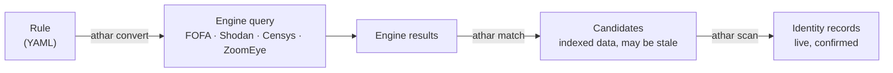

<p align="center">
  
</p>

# Athar

**Athar** (أثر, Arabic for *trace* or *footprint*) is an open rule format that describes what a network service looks like on the wire, plus a tool that uses those rules to find and identify such services on the internet.

One YAML rule describes the observable properties of one service: HTTP title, body, headers, favicon, TLS certificate, JARM, banner. The same rule can

- **convert** into queries for FOFA, Shodan, Censys and ZoomEye, to find candidates in existing scan data, and
- **scan** live services to confirm a hit and identify product, family and version.

The first use case is the infrastructure of **agentic offensive frameworks (AOFs)**: AI-driven penetration testing consoles that are deployed under changing brand names. The format is not limited to them; C2 panels, phishing kits, appliances and ordinary server software fit the same way.

> **Status:** draft v0.1. The rule format can still change. The CLI can verify rules; conversion and scanning are not written yet.

## Why

Every infrastructure hunt gets published three or four times, once per search engine, as hand-written query strings. Those strings drift apart, break when an engine changes its syntax (Censys [deprecated Legacy Search](https://censys.com/blog/legacy-search-deprecation/) in September 2026), and can't be tested.

Existing fingerprint formats each cover part of the problem. Nmap's probe database is tied to Nmap's licence, Recog produces no queries, Nuclei templates are built for vulnerabilities, and Wappalyzer went closed-source. None of them combines an engine-neutral field set, Sigma-style logic, query conversion and active confirmation. [docs/prior-art.md](docs/prior-art.md) compares them.

## A rule

If you can read a Sigma rule, you can read this one. The metadata and the `detection` block are Sigma. New are `target`, `identifies`, `extract`, `confidence` and `tests`.

```yaml
title: AI Autonomous Penetration Testing Console (ARTEX family)
id: 0ce69e91-baee-4475-81ee-4b8eca1a6c3b
status: experimental
author: Gameel Ali (@MalGamy12)
date: 2026-11-24
target:
  protocol: http
  tls: auto
detection:
  selection_title:
    http.title|contains: 'Autonomous Penetration Testing Console'
  selection_route:
    http.body|contains: '/function/tasks'
  condition: selection_title and selection_route
identifies:
  family: ai-autonomous-pentest-console
  category: offensive-tool
extract:
  brand:
    field: http.title
    regex: '^(?P<brand>.+?)\s+[—–-]\s+Autonomous Penetration Testing Console'
confidence: high
level: medium
tests:
  - name: NKW branding
    expect: match
    extracted: { brand: NKW }
    response:
      http.title: 'NKW — Autonomous Penetration Testing Console'
      http.body: '... /function/tasks ...'
```

The full rule, with negative test, validation counts and the original FOFA query, is in [rules/offensive-tool/ai_autonomous_pentest_console.yml](rules/offensive-tool/ai_autonomous_pentest_console.yml).

## How it works



1. **Discover (passive).** `athar convert` turns a rule into one engine's query. Every conversion is labelled `exact`, `approximate`, `superset` or `unsupported`, because engines tokenize text, lack operators or index only part of a body.
2. **Filter (indexed data).** `athar match` runs the exact rule logic on the engine's exported records. That removes the over-matches of approximate queries without sending a packet.
3. **Confirm (active).** `athar scan` probes the remaining services and evaluates the same rule on the live response. The result is an identity record: product, family, extracted values such as brand or version, and confidence.

The **scanner defines what a rule means**. Steps 2 and 3 use the same evaluator, so an engine query can be loose without making the results wrong.

Only `athar verify` exists so far; the other commands are planned. See [cli/](cli/).

## Principles

1. **Simple.** One rule describes one service in one YAML file. Rules use Sigma's grammar rather than a new one. A feature goes into the format only when real rules need it, and [docs/decisions.md](docs/decisions.md) lists the ideas that are waiting for that.
2. **Engine-neutral.** A rule describes properties of a response, never engine syntax. Engine syntax lives in the converters, so a change like Censys's new query language gets fixed in one place.
3. **The scanner defines meaning.** Rule semantics are defined against the raw response. Engine queries are approximations that declare their fidelity.
4. **Passive first, active to confirm.** Rules that only use the baseline request (what engines index anyway) are fully convertible. Extra probes are opt-in, safe by construction, and make those parts active-only.
5. **Identify, don't just alert.** A match yields product, vendor, family, version and CPE, as Recog and Nmap do.
6. **Tested and dated.** Rules carry example responses that run as tests, and hit counts per engine and date, because fingerprints decay.
7. **Licence-clean.** Rules are shared under a permissive licence. Encumbered methods such as JA4S/JA4X are optional fields, never required.

## Scope

One rule matches **one service**: one IP address and one port. Fingerprints that only work when two ports of the same host are combined are deliberately left out of v0.1. [docs/decisions.md](docs/decisions.md#multi-service-fingerprints) explains why and how they could be added later without changing existing rules.

## Repository layout

```text
.
├── README.md               this file
├── spec/
│   └── athar-spec.md       the rule format (normative)
├── rules/                  the rule collection, one folder per category
│   ├── README.md           naming, required tests, rule template
│   └── offensive-tool/
├── cli/                    the athar command-line tool (Go)
│   └── README.md
├── .github/workflows/      CI: Go tests and athar verify on every rule
└── docs/
    ├── prior-art.md        existing formats and what Athar takes from each
    └── decisions.md        decided, open and deferred design questions
```

## CLI

| Command | Status | What it does |
| --- | --- | --- |
| `athar verify` | works | Checks rule syntax and runs every rule's tests. CI runs it on each pull request. |
| `athar convert` | planned | Turns rules into FOFA, Shodan, Censys or ZoomEye queries, with fidelity and warnings. |
| `athar match` | planned | Evaluates rules against stored data (engine exports, recorded responses) without sending packets. |
| `athar scan` | planned | Probes live services and writes identity records as JSONL. |

```bash
go install github.com/Athar-HQ/Athar/cli/cmd/athar@latest
```

The CLI will be written in Go. [docs/decisions.md](docs/decisions.md#cli-in-go) gives the reasons.

## Contributing rules

Rules live in [rules/](rules/), one folder per category. Every rule needs at least one positive and one negative test, a reference to the public source of the hunt, and no engine syntax outside the `native` section. [rules/README.md](rules/README.md) has the conventions and a template.

## Authors

- Florian Roth ([@cyb3rops](https://x.com/cyb3rops)): specification and CLI
- Gameel Ali ([@MalGamy12](https://x.com/MalGamy12)): rules and research

## Licence

Not decided yet. The proposal is the Detection Rule License (DRL) 1.1 for rules, as Sigma uses, and a permissive licence for the code. See [docs/decisions.md](docs/decisions.md#open).
