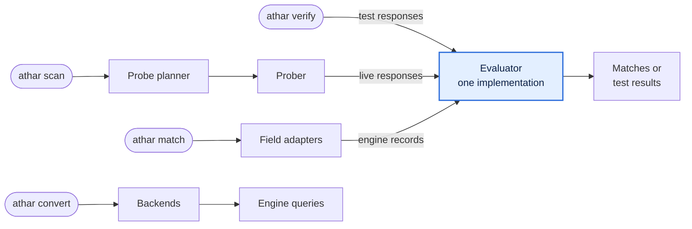

# athar CLI

The reference implementation of the Athar rule format: one Go binary that verifies, converts and evaluates rules, and scans live services.

> **Status:** `athar verify` works. `scan`, `convert` and `match` are planned; their flags below are the target design and may change.

[docs/decisions.md](../docs/decisions.md#cli-in-go) explains why the CLI is written in Go.

## Install and use

Release binaries, `go install` and the `verify` flags are described in the [main README](../README.md#cli).

Not supported yet: tests for custom probes, and `jsonpath` beyond dotted paths such as `$.build.version`.

## Develop

The Go module sits at the repository root (`go.mod`), so one version tag versions the spec, the rules and the CLI together. Requires Go 1.25 or newer. From the repository root:

```bash
go test ./...
```

```bash
go run ./cli/cmd/athar verify -strict rules
```

```bash
go build -o athar ./cli/cmd/athar
```

## Release

Push a version tag. The [release workflow](../.github/workflows/release.yml) runs the tests and `athar verify -strict rules`, builds archives for Linux, macOS and Windows (amd64 and arm64) with [scripts/build-release.sh](../scripts/build-release.sh), and publishes them with `checksums.txt` and generated release notes on the [releases page](https://github.com/Athar-HQ/Athar/releases).

```bash
git tag -a v0.1.0 -m "Athar v0.1.0"
```

```bash
git push origin v0.1.0
```

Tags with a suffix, such as `v0.2.0-rc.1`, become pre-releases. The binary reports the tag in `athar version`. To try the build locally, run `scripts/build-release.sh v0.0.0-test /tmp/athar-dist`.

## Commands

Every command takes rules plus its own input. None of them depends on another command having run first.

| Command | Input | Output | Sends packets |
| --- | --- | --- | --- |
| `athar verify` | Rule files or folders | Schema errors, lint findings, test results; non-zero exit on failure | No |
| `athar scan` | Rules + hosts, CIDR ranges or `host:port` + ports | Matched services (JSONL) | Yes |
| `athar convert` | Rules + target engine | One query per rule, with fidelity and warnings | No |
| `athar match` | Rules + stored data (engine exports, recorded responses) | Matched records (JSONL) | No |

Example session (`verify` output is real; the rest is illustrative):

```text
$ athar verify rules/
rules/offensive-tool/ai_autonomous_pentest_console.yml        2/2 tests passed
rules/offensive-tool/ai_autonomous_pentest_console_artex.yml  3/3 tests passed

2 rules, 0 failed; 5/5 tests passed; 0 errors, 0 warnings

$ athar scan -r rules/ -p 80,443,8000-8100 10.0.0.0/24 > matches.jsonl

$ athar convert -t fofa rules/offensive-tool/ai_autonomous_pentest_console.yml
# AI Autonomous Penetration Testing Console (ARTEX family)  [exact]
title="Autonomous Penetration Testing Console" && body="/function/tasks"

$ athar match -r rules/ --format fofa fofa-export.json > candidates.jsonl
```

## Scanning

`athar scan` works like a small Nmap whose service detection is the Athar rules:

```bash
athar scan -r rules/ -p 80,443,8000-8100 10.0.0.0/24 192.0.2.10 example.org
```

1. **Targets.** IP addresses, hostnames and CIDR ranges as arguments, or one per line with `-iL <file>` (`-` for stdin). A `host:port` target is checked on that port only, so the output of `athar match` or another tool can be fed in directly.
2. **Ports.** `-p` takes a list and ranges, as in Nmap: `-p 22,80,443,8000-8100`. Without `-p`, scan checks a built-in list of common service ports plus every port the loaded rules name in `target.ports`.
3. **Open ports.** A TCP connect to each host and port. This needs no root privileges; ports that refuse or time out are skipped.
4. **Fingerprint.** On each open port, scan runs the baseline probe (TLS handshake when possible, `GET /` and the favicon for HTTP, the banner for raw TCP), plus any custom probes the rules declare if `-probes` is set. Each probe is sent once per port, however many rules use it.
5. **Match.** Every rule is evaluated on the responses. Each matching service is written as one JSON line: target, rule, product or family, extracted values, confidence, matched selections. When a variant and its family both match, the variant wins.

Defaults that keep scanning polite and safe:

- Baseline probe only. Custom probes run only with `-probes`.
- Safe HTTP methods only (GET, HEAD, OPTIONS). Anything else needs an explicit operator flag.
- Rate limit and per-host concurrency limit on by default, adjustable with flags.

UDP scanning and raw SYN scanning are out of scope for the first version.

## Architecture

Each command is its own path through the code. Three of them end in the same evaluator.



`verify` (rule tests), `scan` (live responses) and `match` (engine records) all call the same evaluator, so a rule means the same thing everywhere. That is what keeps approximate conversions honest: `convert` only translates, and anything it lets through is judged by the evaluator later.

- **Probe planner** expands targets and ports and groups rules by the probes they need, like Nuclei's template clustering, so each open port gets each request once.
- **Prober** does the TCP connect check, sends the baseline probe and any opt-in probes, then computes every hash variant: favicon mmh3, MD5 and SHA-256, body hashes, JARM, JA3S.
- **Field adapters** map engine exports (FOFA, Shodan, Censys, ZoomEye) into taxonomy fields.
- **Backends** translate rules into one engine's query language and report the fidelity.
- **Evaluator** is a Sigma condition engine plus extraction, over taxonomy fields.

## Layout

All Go code lives in this folder; the module file (`go.mod`, module `github.com/Athar-HQ/Athar`) sits at the repository root. The only dependency is the YAML parser.

```text
cli/
├── cmd/athar/            main and subcommand wiring
└── internal/
    ├── rule/             load YAML, check metadata against the spec
    ├── condition/        Sigma condition parser
    ├── eval/             the evaluator: modifiers, keywords, probes, extraction, rule tests
    ├── fields/           field taxonomy (engine export adapters later)
    ├── backend/          planned: one file per engine (fofa, shodan, censys, zoomeye)
    ├── probe/            planned: targets and ports, probe planner, prober (TCP, TLS, HTTP, hashes, JARM)
    └── output/           planned: identity records as JSONL
```

Packages stay under `internal/` until the API settles. The evaluator is the first candidate to become public, so other tools can embed Athar rules.

## Build order

1. ~~`rule`, `condition`, `eval` and `athar verify`~~ (done): the evaluator defines what rules mean, and CI needs it first.
2. `probe`, `output` and `athar scan` for TCP, TLS and HTTP: the command people will use most.
3. `backend` and `athar convert` for FOFA, Shodan and Censys.
4. `fields` adapters and `athar match`.
