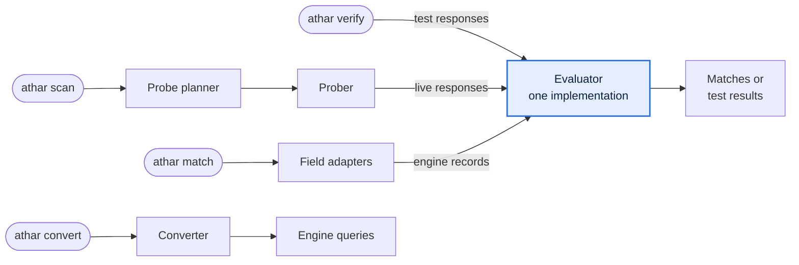

# athar CLI

The reference implementation of the Athar rule format: one Go binary that verifies, converts and evaluates rules, and scans live services.

> **Status:** `athar verify`, `athar scan` and `athar convert` work. `match` is planned; its flags below are the target design and may change.

[docs/decisions.md](../docs/decisions.md#cli-in-go) explains why the CLI is written in Go.

## Install and use

Release binaries, `go install` and the `verify` flags are described in the [main README](../README.md#cli).

Not supported yet: tests for custom probes, and `jsonpath` beyond dotted paths such as `$.build.version`.

## Develop

The Go module sits at the repository root (`go.mod`), so one version tag versions the spec, the rules and the CLI together. Requires Go 1.25 or newer. From the repository root:

```bash
go test ./...
```

```bash
go run ./cli/cmd/athar verify -strict rules
```

```bash
go build -o athar ./cli/cmd/athar
```

## Release

Push a version tag. The [release workflow](../.github/workflows/release.yml) runs the tests and `athar verify -strict rules`, builds archives for Linux, macOS and Windows (amd64 and arm64) with [scripts/build-release.sh](../scripts/build-release.sh), and publishes them with `checksums.txt` and generated release notes on the [releases page](https://github.com/Athar-HQ/Athar/releases).

```bash
git tag -a v0.1.0 -m "Athar v0.1.0"
```

```bash
git push origin v0.1.0
```

Tags with a suffix, such as `v0.2.0-rc.1`, become pre-releases. The binary reports the tag in `athar version`. To try the build locally, run `scripts/build-release.sh v0.0.0-test /tmp/athar-dist`.

## Commands

Every command takes rules plus its own input. None of them depends on another command having run first.

| Command | Input | Output | Sends packets |
| --- | --- | --- | --- |
| `athar verify` | Rule files or folders | Schema errors, lint findings, test results; non-zero exit on failure | No |
| `athar scan` | Rules + hosts, CIDR ranges or `host:port` + ports | Matched services (readable lines, or JSONL with `-json`) | Yes |
| `athar convert` | Rules + engines (`-t`) | One query per rule and engine, with fidelity and notes (JSON with `-json`) | No |
| `athar match` | Rules + stored data (engine exports, recorded responses) | Matched records (JSONL) | No |

Example session (`verify`, `scan` and `convert` output is real; `match` is illustrative):

```text
$ athar verify rules/
rules/offensive-tool/aof_artex.yml             2/2 tests passed
rules/offensive-tool/aof_artex_artex.yml       3/3 tests passed
rules/offensive-tool/aof_artex_basic_auth.yml  2/2 tests passed

3 rules, 0 failed; 7/7 tests passed; 0 errors, 0 warnings

$ athar scan -r rules/ -json -p 80,443,18080 127.0.0.0/30 > matches.jsonl
athar scan: 4 hosts, 12 checks, 1 open, 1 match in 3.1s

$ athar convert -t fofa,modat rules/offensive-tool/aof_artex.yml
Agentic Offensive Framework - ARTEX family  rules/offensive-tool/aof_artex.yml
  fofa     exact        title="Autonomous Penetration Testing Console" && body="/function/tasks"
  modat    approximate  http.title~"Autonomous Penetration Testing Console" and http.body~"/function/tasks"
                        note: modat matches whole words on http.body

$ athar match -r rules/ --format fofa fofa-export.json > candidates.jsonl
```

## Scanning

`athar scan` works like a small Nmap whose service detection is the Athar rules:

```bash
athar scan -r rules/ -p 80,443,8000-8100 10.0.0.0/24 192.0.2.10 example.org
```

1. **Targets.** IP addresses, hostnames and CIDR ranges (up to /16) as arguments, or one per line with `-iL <file>` (`-` for stdin). A `host:port` target is checked on that port only, so the output of `athar match` or another tool can be fed in directly. Checks go port by port across all hosts, so consecutive connections hit different hosts.
2. **Ports.** `-p` takes a list and ranges, as in Nmap: `-p 22,80,443,8000-8100`. Without `-p`, scan checks a built-in list of common service ports (`athar scan -h` prints it) plus every port the loaded rules name in `target.ports`.
3. **Open ports.** A TCP connect to each host and port. This needs no root privileges; ports that refuse or time out are skipped.
4. **Fingerprint.** The scanner only collects what the loaded rules use:
   - **Banner**, only when a rule's `target.protocol` is not `http`: wait up to 2 seconds for the server to speak first (SSH, FTP, SMTP). A banner ends the baseline probe for that port.
   - **TLS** on the same, still unused connection, unless every rule says `tls: none`: certificate fields, version and cipher. SNI is sent only for hostname targets.
   - **HTTP** `GET /` over TLS or plaintext, without following redirects. The `Host` header is the target as given. Body is kept up to 1 MiB, and the title, headers, raw header block and body hashes are computed.
   - **Favicon**, only when a rule uses `http.favicon.*`: from `<link rel="icon">` (also inline `data:` icons), else `/favicon.ico`; icons on other hosts are not fetched.
   - **Custom probes** declared by rules, only with `-probes`. Each distinct probe is sent once per port, however many rules use it.
5. **Match.** Every rule is evaluated on the responses, honouring `target.tls` (`required`, `none`). Each matching service is written as one line: a readable line with target, title, category, confidence and extracted values (coloured on a terminal), or with `-json` a JSON object that also has the rule id, product, family and matched selections. When a variant and its family both match, only the variant is written.

At start, scan warns about rules it can't fully evaluate. Not collected yet: `tls.jarm`, `tls.ja3s`, `tls.ja4s`, `tls.cert.ja4x`, `ssh.hostkey.sha256`, `ssh.kex_algorithms`, and `x-<engine>.` fields. UDP rules are skipped.

Defaults that keep scanning polite and safe:

- Baseline probe only. Custom probes run only with `-probes`, and only with GET, HEAD or OPTIONS.
- At most 200 new connections per second (`-rate`), 50 parallel checks (`-c`), 8 per host (`-per-host`).
- The HTTP `User-Agent` names the tool: `Mozilla/5.0 (compatible; athar/<version>; +https://github.com/Athar-HQ/Athar)`.
- Ranges larger than /16 are refused; split them.
- Ctrl-C stops the scan; matches found so far are already written.

Exit codes: `0` scan completed (with or without matches), `2` usage error, invalid rules, or interrupted.

UDP scanning and raw SYN scanning are out of scope for the first version.

## Architecture

Each command is its own path through the code. Three of them end in the same evaluator.



`verify` (rule tests), `scan` (live responses) and `match` (engine records) all call the same evaluator, so a rule means the same thing everywhere. That is what keeps approximate conversions honest: `convert` only translates, and anything it lets through is judged by the evaluator later.

- **Probe planner** expands targets and ports and works out which parts of the baseline probe the rules need and which custom probes to send, like Nuclei's template clustering, so each open port gets each request once.
- **Prober** does the TCP connect check, sends the baseline probe and any opt-in probes, then computes the hashes: favicon mmh3, MD5 and SHA-256, body mmh3 and SHA-256. JARM and JA3S are planned.
- **Field adapters** map engine exports (FOFA, Shodan, Censys, ZoomEye, Modat) into taxonomy fields.
- **Converter** builds one boolean expression from the condition and selections, pushes negations down to single conditions, lets each engine backend translate them, and replaces what an engine can't express with TRUE so the query can only over-match (the superset rule). Each result is labelled `exact`, `approximate`, `superset` or `unsupported`, with notes.
- **Evaluator** is a Sigma condition engine plus extraction, over taxonomy fields.

## Layout

All Go code lives in this folder; the module file (`go.mod`, module `github.com/Athar-HQ/Athar`) sits at the repository root. The only dependency is the YAML parser.

```text
cli/
├── cmd/athar/            main and subcommand wiring
└── internal/
    ├── rule/             load YAML, check metadata against the spec
    ├── condition/        Sigma condition parser
    ├── eval/             the evaluator: modifiers, keywords, probes, extraction, rule tests
    ├── fields/           field taxonomy (engine export adapters later)
    ├── probe/            targets and ports, prober (TCP, TLS, HTTP, favicon, banner, custom probes), hashes
    ├── scan/             scan runner: probe planning, rate and per-host limits, rule evaluation, precedence
    ├── output/           identity records as readable lines or JSONL
    ├── color/            ANSI colours, only on terminals and without NO_COLOR
    └── convert/          rule to query: expression tree, superset rule, one backend per engine (fofa, shodan, censys, zoomeye, modat)
```

Packages stay under `internal/` until the API settles. The evaluator is the first candidate to become public, so other tools can embed Athar rules.

## Build order

1. ~~`rule`, `condition`, `eval` and `athar verify`~~ (done): the evaluator defines what rules mean, and CI needs it first.
2. ~~`probe`, `scan`, `output` and `athar scan` for TCP, TLS and HTTP~~ (done). Next for scan: JARM, JA3S, SSH host key and key exchange.
3. ~~`convert` and `athar convert` for FOFA, Shodan, Censys, ZoomEye and Modat~~ (done). Next: Censys header search, once its syntax is verified.
4. `fields` adapters and `athar match`.
