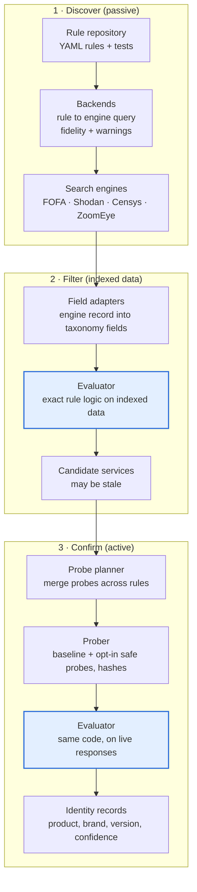

# athar CLI

The reference implementation of the Athar rule format: one Go binary that verifies, converts and evaluates rules, and scans live services.

> **Status:** `athar verify` works. `convert`, `match` and `scan` are planned; their flags below are the target design and may change.

[docs/decisions.md](../docs/decisions.md#cli-in-go) explains why the CLI is written in Go.

## Build and run

Requires Go 1.25 or newer.

```bash
go install github.com/Athar-HQ/Athar/cli/cmd/athar@latest
```

From a checkout:

```bash
cd cli && go build ./cmd/athar && ./athar verify ../rules
```

`athar verify` exits with 0 when every rule is valid and every test passes, 1 on errors or failed tests, and 2 on usage or read errors. `-strict` also fails on warnings (missing positive or negative test, unused selection, unknown top-level key); CI runs it that way.

Not supported yet: tests for custom probes, and `jsonpath` beyond dotted paths such as `$.build.version`.

## Commands

| Command | Input | Output | Sends packets |
| --- | --- | --- | --- |
| `athar verify` | Rule files or folders | Schema errors, lint findings, test results; non-zero exit on failure | No |
| `athar convert` | Rules + target engine | One query per rule, with fidelity and warnings | No |
| `athar match` | Rules + stored data (engine exports, recorded responses) | Identity records (JSONL) | No |
| `athar scan` | Rules + targets (`ip:port`, `ip`, CIDR, file or stdin) | Identity records (JSONL) | Yes |

Example session (`verify` output is real; the rest is illustrative):

```text
$ athar verify rules/
rules/offensive-tool/ai_autonomous_pentest_console.yml        2/2 tests passed
rules/offensive-tool/ai_autonomous_pentest_console_artex.yml  3/3 tests passed

2 rules, 0 failed; 5/5 tests passed; 0 errors, 0 warnings

$ athar convert -t fofa rules/offensive-tool/ai_autonomous_pentest_console.yml
# AI Autonomous Penetration Testing Console (ARTEX family)  [exact]
title="Autonomous Penetration Testing Console" && body="/function/tasks"

$ athar match -r rules/ --format fofa fofa-export.json > candidates.jsonl

$ athar scan -r rules/ -i candidates.jsonl > confirmed.jsonl
```

## Scanning defaults

`athar scan` is not a port scanner. It takes services that are already known (from engine results, `athar match`, or a port scanner such as naabu or masscan) and fingerprints them.

- Baseline probe only. Custom probes run only with `--probes`.
- Safe HTTP methods only (GET, HEAD, OPTIONS). Anything else needs an explicit operator flag.
- Rate limit and per-host concurrency limit on by default.
- Each probe is sent once per target, however many rules use it.

## Architecture



The two highlighted evaluator boxes are one component. `verify` (tests), `match` (engine records) and `scan` (live responses) all call the same evaluator. That is what keeps approximate conversions honest.

- **Field adapters** map engine exports (FOFA, Shodan, Censys, ZoomEye) into taxonomy fields.
- **Probe planner** groups rules by the probes they need, like Nuclei's template clustering, so each target gets each request once.
- **Prober** sends the baseline probe and any opt-in probes, then computes every hash variant: favicon mmh3, MD5 and SHA-256, body hashes, JARM, JA3S.
- **Evaluator** is a Sigma condition engine plus extraction, over taxonomy fields.

## Layout

The CLI is its own Go module inside this folder, so rule contributors never have to touch Go tooling. Its only dependency is the YAML parser.

```text
cli/
├── go.mod                module github.com/Athar-HQ/Athar/cli
├── cmd/athar/            main and subcommand wiring
└── internal/
    ├── rule/             load YAML, check metadata against the spec
    ├── condition/        Sigma condition parser
    ├── eval/             the evaluator: modifiers, keywords, probes, extraction, rule tests
    ├── fields/           field taxonomy (engine export adapters later)
    ├── backend/          planned: one file per engine (fofa, shodan, censys, zoomeye)
    ├── probe/            planned: probe planner and prober (TCP, TLS, HTTP, hashes, JARM)
    └── output/           planned: identity records as JSONL
```

Packages stay under `internal/` until the API settles. The evaluator is the first candidate to become public, so other tools can embed Athar rules.

## Build order

1. ~~`rule`, `condition`, `eval` and `athar verify`~~ (done): the evaluator defines what rules mean, and CI needs it first.
2. `backend` and `athar convert` for FOFA, Shodan and Censys.
3. `fields` adapters and `athar match`.
4. `probe` and `athar scan` for HTTP and TLS.
